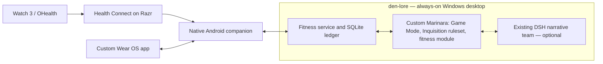

# Implementation outline

Status: accepted direction; implementation not started. Updated: 2026-11-16.

This document and the stage plans are the working implementation plan. Record
ongoing ownership and decisions in [progress.md](progress.md), and post major
information to crew thread `den-01M6WSZV8VFGDJPDSXTE1QS7YF`. Do not use Den tasks.

## Product goal

Make real-world activity feel like preparing an Inquisition character for the
next expedition. A persistent campaign combines exercise, walks, strength work,
mobility, meals, hydration and recovery with character growth, companions,
war-table projects and playable combat.

The first full playtest should have the complete feature set and a finished
first season. Engineering checks, automated tests and focused device bring-up
happen during development. They establish reliability without making Lore test
an unfinished campaign.

The campaign should retain Dragon Age: Inquisition's personalities, world state,
dark fantasy atmosphere, humor and meaningful choices. Story urgency comes from
the conflict with Corypheus. Missed real-world days do not cause losses, damaged
relationships or catch-up debt.

## Working approach

Patch chose a front-loaded build over a vertical slice (2026-11-16). Lore's time
and attention are the bounded resource, so her first contact is the complete
experience, not a series of partial versions.

- **Defaults over questions.** When a detail is unresolved, choose a sensible
  default, record it in the relevant stage file and continue. Extra work that is
  later rolled back is preferred to open TBDs or requests for guidance.
- **Internal playtesting stands in for early Lore feedback.** Agents play the
  campaign through Marinara's real UI against the real ledger, fed by synthetic
  activity histories (busy weeks, illness, missed days, returns). This is where
  fun, pacing, tone and canon are checked before Lore sees anything.
- **Devices are available.** Patch can make Lore's razr ultra and Watch 3
  available for agent testing throughout development. Real health data from them
  stays outside the public repository.
- **Parallel workstreams.** With defaults fixed, most stages proceed at once
  (see [Stages and dependencies](#stages-and-dependencies)).

## Confirmed direction

- Lore's original brief is in the crew thread, posted on 2026-11-08.
- Patch accepted the expanded plan on 2026-11-15 and selected **den-lore for all
  desktop runtime components**, because it is an always-on desktop.
- Target devices: OnePlus Watch 3 and Motorola razr ultra (2025), kept updated.
  Actual versions and Health Connect exports remain unverified.
- Use Marinara Game Mode as the campaign foundation, preserving a conversational,
  character-driven experience. The existing DSH narrative team is an optional
  enhancement behind a toggle (see [Narrative](#data-and-rule-ownership)).
- Preserve the original deliverables: an importable character card, progression
  rules, real dice mechanics, supported combat integration, the five requested
  NPC lorebook entries and a Skyhold opening. The full campaign expands these.
- Patch's 2026-11-16 decisions: front-loaded complete build with defaults over
  questions; mechanical results lock against swipes; the watch is an engagement
  feature in its own right because Lore loves gadgets; Lore's devices are
  available for agent testing; upstreaming to Marinara is unnecessary and a
  sprawling fork is acceptable when the functionality needs it.

## Complete first-playtest scope

| System | Included behavior |
| --- | --- |
| Onboarding | The Inquisitor's name, race (human, elf, dwarf, Qunari; changeable later) and class, world-state and spoiler preferences, companions, goals, quiet hours and device setup |
| Activity journal | Verified automatic imports; manual activity, meals, water and recovery; correction/undo, backdating, provenance and visible sync state |
| Progression | Daily category check-ins, permanent development, talents, preparation resources, equipment/crafting and explainable reward receipts |
| Campaign | Skyhold hub, three authored acts with a complete resolution, regional expeditions, recurring operations and recovery-day content |
| Companions | Solas, Cassandra, Leliana, Cullen, Dorian, Sera, Iron Bull and Blackwall, with individual voice, knowledge and relationship behavior |
| Mechanics and combat | An Inquisition ruleset package for Game Mode: classes, specializations, abilities, items, enemies and combat resolved by the ruleset, with training-derived preparation benefits |
| Locked results | Dice, grants and outcomes on mechanical turns are committed before narration; swipes rewrite prose only. A small, earned reroll resource is the sanctioned exception |
| Desktop UI | Today, Journal, Character, Companions, War Table and Campaign views integrated with Marinara |
| Mobile UI | Native Android dashboard, quick entry, history, notifications, settings and offline queue |
| Watch UI | Shake-to-roll bonus dice with haptics, Leliana's raven notifications, Skyhold readiness complication, Today tile, quick habit entry, companion-framed guided drills and completion haptics |
| Narrative | Game Mode narrator with lorebooks by default; the DSH lore/narrator/reviewer team as an optional per-game toggle that checks prose against committed facts |
| Operations | Install/update, automatic startup, backup/restore, data migration, diagnostics, a Marinara fork update procedure and recovery from ordinary interruptions |

Initial content targets are three complete acts, eight companion profiles,
approximately 20–30 authored mission/scene templates and 10–15 encounter
templates, plus repeatable war-table projects. These are authoring targets,
not completed content or a guarantee that generation will provide the variety.

## Architecture and deployment

| Component | Location / ownership |
| --- | --- |
| Project source | `/home/agent/dev/lore-fitness-rpg` for Linux development; `C:\Dev\lore-fitness-rpg` on den-lore |
| Fitness service | This project's TypeScript service, deployed on den-lore |
| Persistent fitness data | Proposed `C:\Dev\Lore-Fitness-RPG-Data`, outside the source checkout |
| Marinara host changes | A fitness module in `C:\Dev\Marinara-Custom`, following its own repository instructions; deeper Game Mode changes where the functionality needs them |
| Campaign mechanics | An Inquisition ruleset package using Marinara's supported ruleset schema, versioned in this repository |
| Narrative runtime | Existing `C:\Dev\Marinara-DSH`, optional per game |
| Phone/watch | Native Kotlin/Compose applications with persistent local queues, sideloaded with one local signing key |
| Campaign material | Versioned content pack in this repository, imported by the supported Marinara integration |

Use one companion service, not a collection of microservices. Decide actual
ports, launch commands and Windows startup mechanism in stage 1; record the
working operational procedure by stage 6. Do not stop or reconfigure Lore's
existing applications merely to prepare this project. Account for Windows
Update reboots and the firewall rule the phone needs to reach the service.

LAN-first synchronization is sufficient. Mobile clients retain activity while
away from home and reconcile when connectivity returns. Do not make public
hosting or uninterrupted desktop availability a prerequisite for logging.

## Data and rule ownership

1. **Activity and progression:** the fitness ledger is authoritative for event
   identity, source records, timing/timezone, corrections, daily check-ins,
   rule version, grants, XP/level, preparation-resource balances and stored
   bonus rolls. It remains independent of chat history and narrative rewind.
2. **Projection into Game Mode:** the Marinara fitness module writes level and
   build changes into the game build (`chat.metadata.gameCharacterCards[].rulesetSheet`),
   which Marinara does not rewind with swipes. Live, per-turn values (HP,
   resources spent in a scene) stay in Marinara's snapshots, which do rewind.
   Spending preparation resources and war-table actions happen through explicit
   UI actions recorded in the ledger, not through narrated turns, so swipes
   cannot undo or repeat them. Projection receipts prevent duplicate application.
3. **Locked results:** on any mechanical turn (activity reward, check, combat
   result, war-table outcome), code commits the dice, grants and outcome before
   narration. Swipe, regenerate and continue rewrite the prose around the same
   committed results and show a lock marker. Marinara's existing pre-thrown dice
   queue already gives swipes the same values; extend that guarantee to every
   mechanical turn. A recovery-earned reroll resource (default name: a
   "Fade-touched second chance") is the one sanctioned way to change a result.
4. **Narrative:** the narrator — Game Mode's game master by default, the DSH
   team when enabled — receives concise committed facts and writes scenes. It
   may propose actions; code resolves mechanics and balances. When enabled, the
   DSH reviewer checks prose against the committed facts and companion
   knowledge limits, replacing manual swipe-based quality control.

### Default reward model

Each category earns at most once per local day: moved, strength, mobility, meal
habit, hydration goal and rest/recovery. An earned check-in grants fixed base XP
plus one bonus roll with Marinara's dice, stored in the ledger before narration.
Multiple sources for the same category and day (steps, an OHealth workout, a
manual entry) collapse into one check-in; the journal still shows each source.
A daily cap and diminishing preparation returns keep months of logging from
trivializing combat. Numbers in planning documents are balancing placeholders,
not fitness advice; record the actual tuned values in stage 2.

Base rewards can be recorded while Marinara is unavailable. An engine-dependent
bonus stays visibly pending until the adapter resolves and records it once.
Narration retries must not reroll that bonus. Backup restore of either side
must preserve real activity and reconcile grants with campaign spending.

Reward consistency and personal goals, with equivalent accessible alternatives.
Any activity can support any chosen character class. Recovery is a useful path;
do not tie rewards to extreme heart rate, weight loss or escalating water intake.

## Integration boundaries to preserve

The source inspection on 2026-11-15 found Marinara 2.5.0 on `custom/agent-turn`,
revision `3050e9a406c4ab23279b9e0b4fb067c2db252047`; a recheck on 2026-11-16
found the same revision. Recheck before editing.

- Game Mode has no automatic progression. The game master writes the general
  sheet and manages inventory; for rulesets, "the sheet stores XP, nothing awards
  it automatically, and level is edited by hand." Awarding progression is new work.
- Live sheet values belong to the turn and rewind with swipes; the game build
  does not. Grants must not be applied as ordinary turn-level sheet changes.
- Game Mode records checkpoints but has no in-app restore. Checkpoint restore is
  out of scope; backup restore is the supported recovery path.
- Custom ruleset packages are the supported way to define sheets, abilities,
  items, enemies and ruleset-resolved combat.
- By default, regenerating a turn rolls a new set of dice; the pre-thrown dice
  queue mode faces the same values on swipe, regenerate and continue.
- DSH's current team integration handles ordinary Roleplay replies; it is not
  integrated with Game Mode's structured turn flow. Original Marinara model tool
  definitions do not automatically become DSH tools.
- `update_game_state` only exposes time and location. New progression operations
  need explicit, implemented interfaces.
- Marinara personal server extensions are unavailable on Windows. Use a focused
  first-class host module; deeper changes are acceptable where needed.
- The existing Marinara Android APK is a Termux/WebView launcher, not the native
  health and watch companion planned here.

The [reference map](references.md) identifies owning source paths. These are
source-level observations, not passed runtime tests.

## Stages and dependencies

| Stage | Outcome | Can start |
| --- | --- | --- |
| [1 — Platform contract](01-platform-contract.md) | A few targeted runtime checks and the den-lore runtime plan | Now |
| [2 — Durable mechanics](02-durable-mechanics.md) | Ledger, daily check-ins, reward rules, deduplication, corrections and replay | Now, using the defaults above |
| [3 — Marinara integration](03-marinara-integration.md) | Fitness module, game-build projection, locked results, desktop UI, then optional DSH | Now; DSH after the Game Mode path works |
| [4 — Phone and watch](04-phone-and-watch.md) | Native companions, gadget features and reliable device sync | Now, against Health Connect's documented API, emulators and the real devices |
| [5 — Ruleset and campaign](05-campaign-season.md) | Inquisition ruleset, complete first season and content pack | Now |
| [6 — Stabilization and release](06-stabilization-and-release.md) | Internal full-season playthrough, installed release and first Lore playtest | Harness now; release once 1–5 integrate |

These are parallel workstreams, not approval gates. Record ownership in the stage
files and [progress.md](progress.md) so concurrent agents do not collide. Stage 1's
checks feed later stages, but an unanswered check is handled with a recorded
default rather than blocking work.

## First-playtest acceptance

- Every supported activity can reach a visible, explainable journal entry and
  the intended reward. Manual entry remains useful when optional sensors fail.
- Duplicate delivery, delayed imports, edits and cross-source overlap do not
  silently inflate or erase earned progression.
- Regeneration, swipes, continuation, restart and backup restore preserve real
  activity, the original grant, the original reward roll and every locked result.
- A complete campaign run includes meaningful companion choices, preparation,
  an expedition, playable combat and a season conclusion.
- An internal full-season playthrough on the release build, with synthetic
  activity history, is completed and its defects resolved before Lore plays.
- A week of queued mobile activity can reconcile without duplicate XP.
- The watch's shake-to-roll, raven notifications, complication and guided
  drills work on Lore's Watch 3.
- Recovery and missed-day paths remain welcoming and playable.
- Backup restore and an update with existing saves are demonstrated.
- Release-build battery use and latency are measured on the actual devices;
  agree targets using those measurements rather than invented estimates.

## Distribution and expansion

Sideload phone and watch APKs signed with one local key kept outside the
repository on den-lore. Keep application identity and signing consistent across
phone/watch modules and updates. Play Console distribution is out of scope for
this household release; revisit only if a wider audience is ever planned.

Separate campaign content from the fitness ledger and transport. Later campaign
packs, regions, companions, wearable adapters, voice features and optional shared
war-table goals should reuse those foundations. Implement the current household
experience before adding infrastructure for hypothetical larger deployments.
