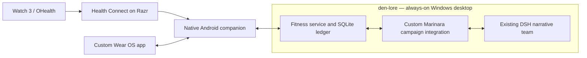

# Implementation outline

Status: accepted direction; implementation not started. Updated: 2026-11-15.

This document and the stage plans are the working implementation plan. Record
ongoing ownership and decisions in [progress.md](progress.md), and post major
information to crew thread `den-01M6WSZV8VFGDJPDSXTE1QS7YF`. Do not use Den tasks.

## Product goal

Make real-world activity feel like preparing an Inquisition character for the
next expedition. A persistent campaign combines exercise, walks, strength work,
mobility, meals, hydration and recovery with character growth, companions,
war-table projects and playable combat.

The first full playtest should have the complete feature set and a finished
first season. Engineering checks, automated tests and focused device bring-up
happen during development. They establish reliability without making Lore test
an unfinished campaign.

The campaign should retain Dragon Age: Inquisition's personalities, world state,
dark fantasy atmosphere, humor and meaningful choices. Story urgency comes from
the conflict with Corypheus. Missed real-world days do not cause losses, damaged
relationships or catch-up debt.

## Confirmed direction

- Lore's original brief is in the crew thread, posted on 2026-11-08.
- Patch accepted the expanded plan on 2026-11-15 and selected **den-lore for all
  desktop runtime components**, because it is an always-on desktop.
- Target devices: OnePlus Watch 3 and Motorola razr ultra (2025), kept updated.
  Actual versions and Health Connect exports remain unverified.
- Use Marinara Game Mode as the campaign foundation, preserving a conversational,
  character-driven experience and extending the existing DSH narrative team.
- Preserve the original deliverables: an importable character card, progression
  rules, real dice mechanics, supported combat integration, the five requested
  NPC lorebook entries and a Skyhold opening. The full campaign expands these.

## Complete first-playtest scope

| System | Included behavior |
| --- | --- |
| Onboarding | Character identity/class, relation to the Inquisitor, world-state and spoiler preferences, companions, goals, quiet hours and device setup |
| Activity journal | Verified automatic imports; manual activity, meals, water and recovery; correction/undo, backdating, provenance and visible sync state |
| Progression | Permanent development, talents, preparation resources, equipment/crafting and explainable reward receipts |
| Campaign | Skyhold hub, three authored acts with a complete resolution, regional expeditions, recurring operations and recovery-day content |
| Companions | Solas, Cassandra, Leliana, Cullen, Dorian, Sera, Iron Bull and Blackwall, with individual voice, knowledge and relationship behavior |
| Combat | Existing Game Mode mechanics, curated abilities/enemies, party decisions and meaningful training-derived preparation benefits |
| Desktop UI | Today, Journal, Character, Companions, War Table and Campaign views integrated with Marinara |
| Mobile UI | Native Android dashboard, quick entry, history, notifications, settings and offline queue |
| Watch UI | Today tile, mission progress, complication, quick habit entry, guided workout controls and completion haptics |
| Operations | Install/update, automatic startup, backup/restore, data migration, diagnostics and recovery from ordinary interruptions |

Initial content targets are three complete acts, eight companion profiles,
approximately 20–30 authored mission/scene templates and 10–15 encounter
templates, plus repeatable war-table projects. These are authoring targets,
not completed content or a guarantee that generation will provide the variety.

## Architecture and deployment

| Component | Location / ownership |
| --- | --- |
| Project source | `/home/agent/dev/lore-fitness-rpg` for Linux development; `C:\Dev\lore-fitness-rpg` on den-lore |
| Fitness service | This project's TypeScript service, deployed on den-lore |
| Persistent fitness data | Proposed `C:\Dev\Lore-Fitness-RPG-Data`, outside the source checkout |
| Marinara host changes | Focused changes in `C:\Dev\Marinara-Custom`, following its own repository instructions |
| Narrative runtime | Existing `C:\Dev\Marinara-DSH`; extend its current integration |
| Phone/watch | Native Kotlin/Compose applications with persistent local queues |
| Campaign material | Versioned content pack in this repository, imported by the supported Marinara integration |

Use one companion service, not a collection of microservices. Decide actual
ports, launch commands and Windows startup mechanism in stage 1; record the
working operational procedure by stage 6. Do not stop or reconfigure Lore's
existing applications merely to prepare this project.

LAN-first synchronization is sufficient. Mobile clients retain activity while
away from home and reconcile when connectivity returns. Do not make public
hosting or uninterrupted desktop availability a prerequisite for logging.

## Data and rule ownership

1. **Activity and earned grants:** the fitness ledger stores event identity,
   source records, timing/timezone, corrections, rule version and reward receipts.
   It remains independent of chat history and narrative rewind.
2. **Campaign state:** Marinara owns character choices, spending, inventory,
   relationships, quests and combat. Save/checkpoint projection records establish
   which grants have been applied and prevent duplicate application.
3. **Narrative:** DSH receives concise committed facts, retrieves relevant lore
   and writes scenes. It may propose actions; code resolves mechanics and balances.

Grant guaranteed base recognition for qualifying effort. Use real Marinara dice
for additional rewards or fictional consequences, saving the original result.
For illustration, a walk might grant 20 XP and a `1d6` supply roll; the numbers
are balancing placeholders, not implemented rules or fitness advice.

Base rewards can be recorded while Marinara is unavailable. An engine-dependent
bonus stays visibly pending until the adapter resolves and records it once.
Narration retries must not reroll that bonus. Checkpoint restore must preserve
real activity and reconcile grants with restored campaign spending.

Reward consistency and personal goals, with equivalent accessible alternatives.
Any activity can support any chosen character class. Recovery is a useful path;
do not tie rewards to extreme heart rate, weight loss or escalating water intake.

## Integration boundaries to preserve

The source inspection on 2026-11-15 found Marinara 2.5.0 on `custom/agent-turn`,
revision `3050e9a406c4ab23279b9e0b4fb067c2db252047`. Recheck before editing.

- DSH's current team integration handles ordinary Roleplay replies; it is not
  already integrated with Game Mode's complete structured turn flow.
- DSH's stage currently supplies lore/narration/review. Original Marinara model
  tool definitions do not automatically become DSH tools.
- Game Mode and Roleplay encounter combat have separate behavior. Reuse the
  engine-resolved Game Mode path for dependable progression.
- `update_game_state` only exposes time and location in that revision. New
  progression operations need explicit, implemented interfaces.
- Marinara personal server extensions are unavailable on Windows in that
  revision. Use a focused first-class host integration.
- The existing Marinara Android APK is a Termux/WebView launcher, not the native
  health and watch companion planned here.

The [reference map](references.md) identifies owning source paths. These are
source-level observations, not passed runtime tests.

## Stages and dependencies

| Stage | Outcome | Dependencies |
| --- | --- | --- |
| [1 — Platform contract](01-platform-contract.md) | Verified integration assumptions and synthetic end-to-end receipt | None |
| [2 — Durable mechanics](02-durable-mechanics.md) | Journal, reward rules, deduplication, corrections and replay | Stage 1 contracts |
| [3 — Marinara integration](03-marinara-integration.md) | Persistent campaign projection, dice/combat integration, DSH bridge and desktop UI | Stages 1–2 |
| [4 — Phone and watch](04-phone-and-watch.md) | Complete native companions and reliable device sync | Stage 1 device checks and stage 2 API |
| [5 — Campaign season](05-campaign-season.md) | Complete authored first season and content pack | Canon authoring can start early; final integration needs stages 2–3 |
| [6 — Stabilization and release](06-stabilization-and-release.md) | Installed, maintainable complete first testing release | Stages 1–5 integrated |

These are work packages, not approval gates. Record progress in the stage files
and [progress.md](progress.md). Work on independent areas can overlap when the
contracts are clear and ownership is recorded.

## First-playtest acceptance

- Every supported activity can reach a visible, explainable journal entry and
  the intended reward. Manual entry remains useful when optional sensors fail.
- Duplicate delivery, delayed imports, edits and cross-source overlap do not
  silently inflate or erase earned progression.
- Regeneration, swipes, restart and checkpoint restore preserve real activity,
  the original grant and the original reward roll.
- A complete campaign run includes meaningful companion choices, preparation,
  an expedition, playable combat and a season conclusion.
- A week of queued mobile activity can reconcile without duplicate XP.
- Recovery and missed-day paths remain welcoming and playable.
- Backup restore and an update with existing saves are demonstrated.
- Release-build battery use and latency are measured on the actual devices;
  agree targets using those measurements rather than invented estimates.

## Distribution and expansion

Use direct APK installation for engineering builds. The proposed convenient
distribution route is a Play Console internal testing track; account enrollment
and purchase have not happened. Keep application identity and signing consistent
across phone/watch modules and updates. Recheck platform requirements at release.

Separate campaign content from the fitness ledger and transport. Later campaign
packs, regions, companions, wearable adapters, voice features and optional shared
war-table goals should reuse those foundations. Implement the current household
experience before adding infrastructure for hypothetical larger deployments.
